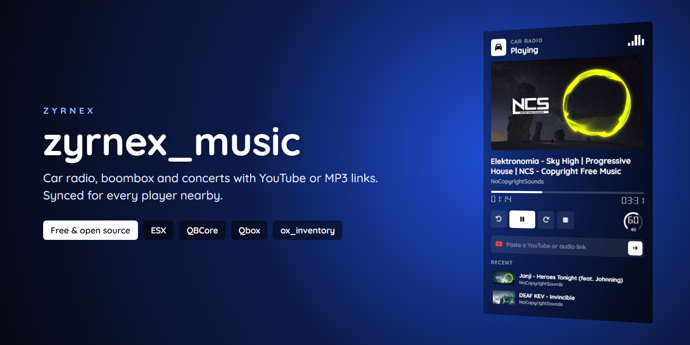
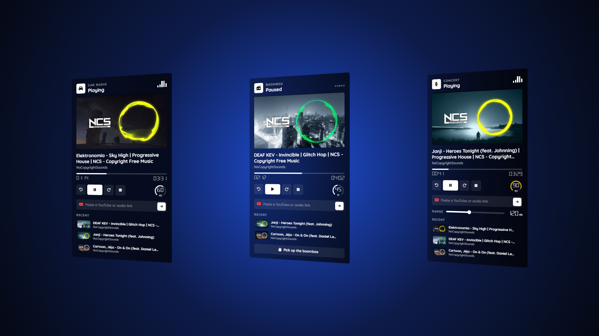

# zyrnex_music

Car radio, portable boombox and concerts for FiveM. Paste a YouTube or MP3 link and everyone nearby hears it in 3D, synced, even if they join later.



## Features

- **Car radio**: the driver plays music from the car with `/carradio`. The sound follows the vehicle and stops when you get out.
- **Boombox**: use the item to place it on the ground. Only the owner can control it or pick it up, using ox_target.
- **Concerts**: staff can start a concert with `/concert [range]` and change the range live, up to 300 m.
- Play, pause, stop, seek ±10 s, drag the progress bar and change the volume with the wheel or arrow keys.
- YouTube cover, title and channel, plus a list of recent songs saved on each player.
- Players who join later hear the song at the right second.
- Everything is validated on the server: links, volume, range, ownership and distance.
- No framework code. Works on ESX, QBCore, Qbox or standalone.
- English and Spanish included.

## Requirements

- [ox_lib](https://github.com/overextended/ox_lib)
- [ox_inventory](https://github.com/overextended/ox_inventory)
- [ox_target](https://github.com/overextended/ox_target)
- [xsound](https://github.com/Xogy/xsound)

## Installation

1. Download the latest release and drop the `zyrnex_music` folder into your `resources`.
2. Add it to your `server.cfg` after its dependencies:

   ```cfg
   ensure ox_lib
   ensure ox_inventory
   ensure ox_target
   ensure xsound
   ensure zyrnex_music
   ```

3. Add the boombox item to `ox_inventory/data/items.lua`:

   ```lua
   ['boombox'] = {
       label = 'Boombox',
       weight = 2000,
       stack = false,
       server = {
           export = 'zyrnex_music.boombox'
       }
   },
   ```

   Put a `boombox.png` image in `ox_inventory/web/images`.

4. Give concert permission to your staff in `server.cfg`:

   ```cfg
   add_ace group.admin zyrnex_music.concert allow
   ```

## Configuration

Everything is in `config.lua`.

| Option | Default | What it does |
|---|---|---|
| `Config.Locale` | `"en"` | `"en"` or `"es"`. Add more in `locales/` |
| `Config.Commands.carRadio` | `"carradio"` | Command to open the car radio |
| `Config.Commands.concert` | `"concert"` | Command to start a concert |
| `Config.ConcertAce` | `"zyrnex_music.concert"` | ACE needed to start concerts |
| `Config.BoomboxItem` | `"boombox"` | Item name |
| `Config.BoomboxProp` | `"prop_boombox_01"` | Prop placed on the ground |
| `Config.MaxBoomboxes` | `1` | Boomboxes per player at once |
| `Config.RadioDistance` | `2.5` | Distance to use the boombox |
| `Config.DefaultVolume` | `0.5` | Starting volume (0.0 to 1.0) |
| `Config.MaxVolume` | `1.0` | Maximum volume |
| `Config.DefaultConcertRadius` | `50` | Concert range in metres if none is given |
| `Config.MaxConcertRadius` | `300` | Maximum concert range |

## Controls

| Key | Action |
|---|---|
| `Space` | Play or pause |
| `←` `→` | Seek 10 seconds |
| `↑` `↓` / mouse wheel | Volume |
| `Ctrl + V` | Play a copied link |
| `Esc` | Close |

## Credits

- Made by Lucas M. for [Zyrnex](https://github.com/lucasm6195).
- 3D audio by [xsound](https://github.com/Xogy/xsound).
- Digital font [DSEG](https://github.com/keshikan/DSEG) by keshikan, under the SIL Open Font License 1.1 (`ui/fonts/DSEG-LICENSE.txt`).
- Covers in the screenshots belong to [NoCopyrightSounds](https://www.youtube.com/@NoCopyrightSounds).

## License

[GPL-3.0](LICENSE). You can use it, change it and share it, but the code has to stay open and keep the credits.
